<div align="center">



</div>

## 👋 About me

I started programming at age 13 with web development and haven't stopped learning since working on websites, full-stack applications, and desktop games, as well as participating in robotics competitions. I enjoy understanding how things work at every level, from CSS transitions to computer vision.

- 🎓 Computer Science **MSOE** (Milwaukee, WI)
- 🔭 Building **Jarvis**, a Python AI assistant powered by the Claude API and OpenCV
- 📱 Learning **React Native**
- 🤖 Former **FIRST Robotics** competitor (Java + OpenCV)

---

## 🛠️ technologies

<div align="center">


<br/>


</div>

| Area | What I use |
|---|---|
| 🎨 **Front-end** | React, JavaScript, HTML/CSS (Flexbox, Grid, positioning, media queries, transitions), React Native *(learning)* |
| ⚙️ **Back-end** | PHP, MySQL, Node.js, session-based auth, password hashing |
| 🖥️ **Desktop** | C++ with Qt, packaged with Inno Setup installers |
| ☕ **Java & Robotics** | Java, FIRST Robotics library, OpenCV |
| 🧠 **AI / Vision** | Python, Claude API, OpenCV (face detection) |

---

## 🚀 Featured projects

| Project | What it is | Stack |
|---|---|---|
| 🌟 [**Star Collector**](https://github.com/kclavasquinrivera/Star-Collector) | 2D browser platformer: jump, collect stars, dodge bombs that get harder over time |  |
| 📇 [**phpmysql**](https://github.com/kclavasquinrivera/phpmysql) | Contact manager with registration, hashed-password login, sessions and per-user CRUD |   |
| 🧱 [**Block-Game**](https://github.com/kclavasquinrivera/Block-Game) | Desktop game written in C++ |  |
| ⌨️ [**my_vim_workspace**](https://github.com/kclavasquinrivera/my_vim_workspace) | Custom Vim setup: shortcuts, integrated terminal, code runner, plugins |  |

<details>
<summary><b>📚 More projects (Java, school work)</b></summary>
<br/>

- [Console-Games-Collection](https://github.com/kclavasquinrivera/Console-Games-Collection): dice games, card games, Yahtzee and Pig in Java
- [Business-management-system-with-Java](https://github.com/kclavasquinrivera/Business-management-system-with-Java): department-based login, sales, inventory and finance (AP CSA project)
- [Geometric-Pattern](https://github.com/kclavasquinrivera/Geometric-Pattern): rotating triangle animations using trigonometry and OOP

</details>

---

## 🤖 Currently building: Jarvis

> A personal AI assistant that lives in my own device ecosystem.

```text
 Camera ──► OpenCV (face detection) ──┐
                                      ├──► Python core ──► Claude API ──► Jarvis
 Voice / text input ──────────────────┘
```

- ✅ Face detection with OpenCV
- 🔄 Claude API integration for conversation and reasoning
- 🔜 Integration with the rest of my ecosystem

*Status: in development.*

---

## 🧭 My journey

```text
adolescents ──► Web development (HTML, CSS, JS)
            └──► Front-end: Flexbox/Grid, transitions, React
            └──► Back-end: PHP, MySQL, Node.js
            └──► Desktop apps: C++, Qt, Inno Setup
High school ──► AP Computer Science (Java) + FIRST Robotics (Java, OpenCV)
Today ──► CS MSOE · React Native · Jarvis (Python + Claude API)
```

---

## 📊 GitHub stats

<div align="center">


</div>


